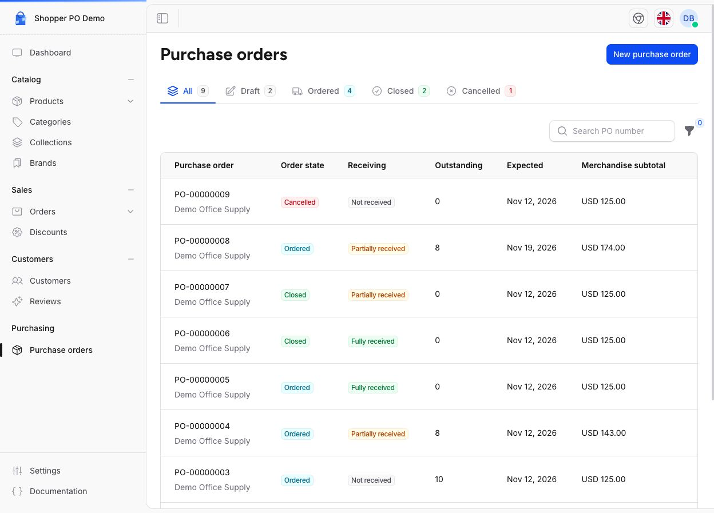

<h1 align="center">Shopper Purchase Orders</h1>

<p align="center">A community add-on for Laravel Shopper that tracks supplier purchase orders and records incoming inventory.</p>

<p align="center">
    <a href="https://github.com/ShaungBhone/shopper-po/actions/workflows/tests.yml"></a>
    <a href="https://packagist.org/packages/shaungbhone/shopper-po"></a>
    <a href="LICENSE"></a>
</p>

<p align="center">
    
</p>

## Install

The add-on requires an existing [Laravel Shopper](https://laravelshopper.dev/) installation with Shopper `>=2.12.1 <2.13.0`, Laravel 12, and PHP 8.3 or later.

Run these commands from your Shopper application:

```sh
composer require shaungbhone/shopper-po:^1.0
php artisan migrate
php artisan purchase-orders:install
php artisan optimize:clear
```

Laravel package discovery registers the add-on with Shopper. The install command creates the purchase order permissions and can be run again safely.

1. Enable the supplier feature in `config/shopper/features.php` by setting `supplier` to `\Shopper\Enum\FeatureState::Enabled`. Set up an enabled supplier and an inventory location in Shopper.
2. Assign the purchase order permissions in Shopper's team settings, or run `php artisan purchase-orders:install --role=your-existing-role` to grant them to an existing Shopper role.
3. Open **Purchasing → Purchase orders** in the Shopper admin.

If you change the supplier feature after clearing the configuration cache, run `php artisan optimize:clear` again.

## Use

Create a draft, choose the products and unit costs, and mark the order as ordered when the supplier confirms it. Record partial or final deliveries against the outstanding quantities. Accepted units increase stock at the order's inventory location and appear in Shopper's stock history.

Rejected units can await replacement or be waived. Correct a receipt to fix a receiving mistake and keep an audit trail, or close the order to waive the remaining balance.

New orders use enabled currencies from Shopper's **Settings → Currencies**, with the store currency selected by default. Existing drafts retain their saved currency if it is later disabled. Amounts follow Shopper's currency precision.

## Disable the add-on

Set `'purchase-orders' => false` in `config/shopper/addons.php` and run `php artisan optimize:clear`. If the file does not exist, create it with a PHP configuration array containing that entry. Disabling the add-on removes its screens from the admin and preserves existing purchase orders and receipts.

## Development

From the package checkout:

```sh
composer install
npm ci
composer test
npm run format:check
```

The default suite uses SQLite. See the [test workflow](.github/workflows/tests.yml) for the MySQL and concurrency test settings.

Shopper documents the integration points in its [add-on guide](https://docs.laravelshopper.dev/v2/addons).

## License

Released under the [MIT license](LICENSE).
